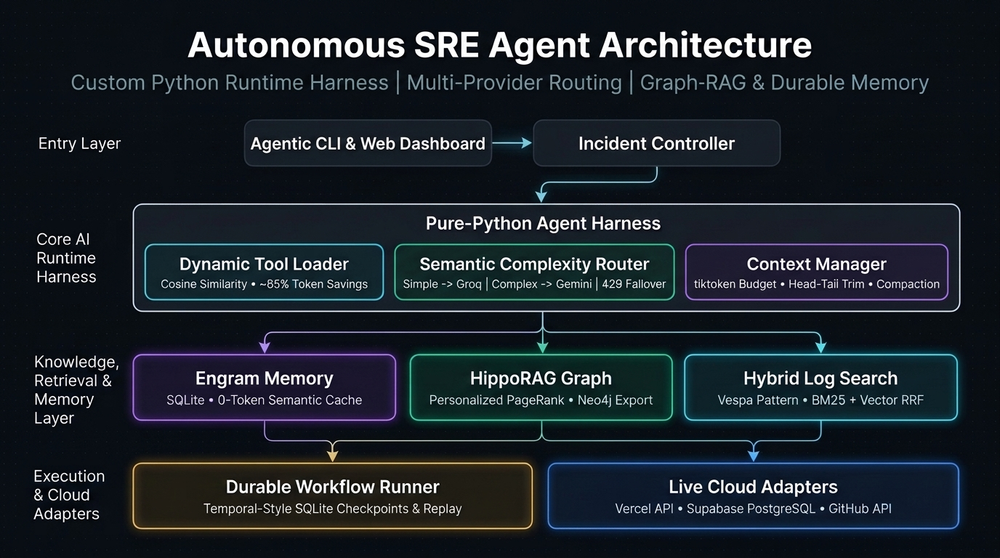

# Autonomous SRE Agent (`sre-agent`)



A production-grade **Autonomous SRE & Production Incident Investigator** built from scratch in pure Python using a clean, flat **Router → Controller → Service → Adapter** architecture (no unnecessary inheritance or framework bloat).

Connected to live **Vercel**, **Supabase PostgreSQL**, and **GitHub** infrastructure, it solves the core systems bottlenecks that break production AI agents: **prompt token bloat, rate-limit outages, context overflow, multi-hop root-cause discovery, memory drift, and mid-run crashes**.

---

## Key Capabilities & Architecture

### 1. Core AI Runtime Harness (`services/` + `helpers/`)
* **Dynamic Tool Loading (`services/tool_service.py`):** Embeds tool descriptions locally using lightweight ONNX embeddings (`BAAI/bge-small-en-v1.5` via `fastembed`) and uses in-memory NumPy cosine similarity (`~0.1ms`) to inject **only the Top-K matching tools** per query—reducing tool-schema prompt overhead by **~65%**.
* **Semantic Complexity Router (`helpers/complexity.py`):** Zero-token semantic classification splits simple lookups/health checks to **Groq (`fast` tier)** and complex crash investigations or unknown/ambiguous queries to **Google Gemini (`smart` tier)**, with runtime auto-escalation after multi-step tool chains.
* **Multi-Provider LLM Gateway (`adapters/llm_adapter.py`):** OpenAI-compatible router across **Google Gemini** and **Groq** with **60s circuit-breaker cooldowns** and automatic **HTTP 429 / 5xx bidirectional failover**.
* **Context Manager (`services/context_service.py` + `helpers/tokens.py`):** Exact `tiktoken` (`cl100k_base`) token budgeting, **40/60 Head-Tail log truncation** (preserving both log headers and bottom crash stack traces), and automated **fast-tier history compaction** whenever working memory reaches 75% capacity.
* **Safety Guardrails (`services/agent_service.py`):** Pure-Python execution loop with max-step limits and **Human-in-the-Loop (`[y/N]`) approval** blocking destructive actions (e.g., production rollbacks) unless explicitly confirmed.

### 2. Knowledge, Retrieval & Memory Layer
* **Engram Long-Term Episodic Memory (`services/memory_service.py`):** Persistent SQLite + vector store that recalls past incidents across sessions, deduplicates similar episodes on write, and provides a **TTL Semantic Cache** yielding **0-token cache hits** on repeated queries.
* **HippoRAG Multi-Hop Knowledge Graph (`services/graph_service.py`):** Neuro-inspired associative retrieval running **Personalized PageRank** (NumPy power iteration) over app-to-database topology (`GitHub Repo → Vercel App → Supabase Tables`) to surface hidden multi-hop root causes, with ready-to-run **Neo4j Cypher export & live sync**.
* **Hybrid Log Retrieval (`services/retrieval_service.py`):** **Vespa-pattern** BM25Okapi lexical + Dense Vector search fused via **Reciprocal Rank Fusion (RRF)**—catching both exact error codes (`PGRST301`, `HTTP 504`) and conceptual outages with zero shared keywords—plus a production **Vespa `.sd` schema export**.

### 3. Durable Execution & Clean Adapters (`adapters/`)
* **Durable Workflow Runner (`adapters/durable_adapter.py`):** **Temporal-style** SQLite event-history checkpointing with automatic retry backoff. Restarting an interrupted run with the same `--workflow-id` replays completed steps from disk with **zero re-execution and zero wasted tokens**.
* **Live Cloud Adapters:** Plain, readable adapters for **Vercel API** (`vercel_adapter.py`), **Read-Only Supabase PostgreSQL `pg_stat_activity`** (`supabase_adapter.py`), and **GitHub REST API** (`github_adapter.py`), each supporting both **Sandbox Mode** and **Live Mode**.

---

## Project Structure

```text
sre-agent/
├── assets/
│   └── linkedin_architecture.jpg    # System architecture diagram
├── src/sre_agent/
│   ├── __main__.py                  # CLI entrypoint (`python -m sre_agent`)
│   ├── routers/
│   │   ├── cli_router.py            # Terminal CLI command router
│   │   └── streamlit_app.py         # 4-tab interactive Web Dashboard
│   ├── controllers/
│   │   └── incident_controller.py   # Orchestrates the 4-step durable SRE pipeline
│   ├── services/
│   │   ├── agent_service.py         # Core Agent Harness loop + safety guardrails
│   │   ├── tool_service.py          # Dynamic semantic tool registry + adapter bindings
│   │   ├── context_service.py       # Token budgeting + fast-tier auto-compaction
│   │   ├── memory_service.py        # Engram SQLite episodic memory + 0-token cache
│   │   ├── graph_service.py         # HippoRAG Personalized PageRank + Neo4j Cypher
│   │   └── retrieval_service.py     # Hybrid BM25 + Vector RRF + Vespa schema
│   ├── adapters/
│   │   ├── llm_adapter.py           # Multi-provider Gemini/Groq router + 429 failover
│   │   ├── vercel_adapter.py        # Vercel deployments, logs, URL probes & rollbacks
│   │   ├── supabase_adapter.py      # Read-only PostgreSQL slow query & lock inspector
│   │   ├── github_adapter.py        # GitHub commit history adapter
│   │   └── durable_adapter.py       # Temporal-style SQLite step checkpoints & replay
│   ├── config/
│   │   └── constants.py             # Centralized URLs, model tiers, prompts & budgets
│   ├── helpers/
│   │   ├── embeddings.py            # Shared local ONNX embedder + cosine similarity
│   │   ├── tokens.py                # tiktoken counter + 40/60 Head-Tail log trimmer
│   │   └── complexity.py            # Zero-token semantic task complexity router
│   └── schemas/
│       └── models.py                # Plain Python dataclasses shared across layers
├── examples/                        # Zero-token offline verification scripts (Steps 1–6)
├── .env.example                     # Safe environment variable template
├── .gitignore                       # Excludes .env, .venv, and local SQLite *.db files
└── requirements.txt
```

---

## Installation & Setup

### Prerequisites
* Python **3.10+** (tested on Python 3.12)
* Optional: [`uv`](https://docs.astral.sh/uv/) for fast virtual environment setup

### 1. Clone the Repository
```bash
git clone https://github.com/Dakshak-Data/autonomous-sre-agent.git
cd autonomous-sre-agent
```

### 2. Create Virtual Environment & Install Dependencies

**Option A: Using `uv` (Recommended — Fast)**
```bash
uv venv
uv pip install -r requirements.txt
```

**Option B: Using standard `pip`**
```bash
python3 -m venv .venv
source .venv/bin/activate   # On Windows: .venv\Scripts\activate
pip install -r requirements.txt
```

### 3. Configure Environment Variables
Copy `.env.example` to `.env` (`.env` is strictly git-ignored):
```bash
cp .env.example .env
```

Edit `.env` and add your free API keys:
```env
# Free LLM Tiers (Multi-Provider Auto-Failover)
GEMINI_API_KEY=your_google_gemini_api_key
GROQ_API_KEY=your_groq_api_key

# Optional: Live Cloud Adapters (leave blank to run in Sandbox Mode)
VERCEL_TOKEN=
SUPABASE_DB_URL=
GITHUB_TOKEN=

# Optional: Target Production App Metadata (for HippoRAG Topology)
TARGET_APP_NAME=my-web-app
TARGET_APP_URL=https://my-web-app.vercel.app
TARGET_GITHUB_REPO=your-username/your-repo
TARGET_DB_TABLES=users,orders,payments,sessions
```

---

## How to Run

### 1. Run Zero-Token Verification Suite (0 API Cost — Works Offline!)
Verify every individual module and crash-resume workflow without spending any API tokens:
```bash
.venv/bin/python examples/test_step1_tools.py             # Dynamic Tool Loading (~65% savings)
.venv/bin/python examples/test_step2_router.py            # 429 Failover & Circuit Breaker
.venv/bin/python examples/test_step3_harness.py           # Truncation, Compaction & Guardrails
.venv/bin/python examples/test_step4_memory_graph.py      # Engram SQLite & HippoRAG PageRank
.venv/bin/python examples/test_step5_hybrid_and_tools.py  # Hybrid BM25 + Vector RRF Search
.venv/bin/python examples/test_step6_full_pipeline.py     # Full Pipeline + Durable Replay
```

### 2. Run the Agentic CLI

**Offline Sandbox Mode (0 LLM tokens):**
```bash
PYTHONPATH=src .venv/bin/python -m sre_agent "Investigate 504 timeout and slow database queries"
```

**Live LLM Mode (Uses Gemini + Groq with Semantic Complexity Routing & Auto-Failover):**
```bash
PYTHONPATH=src .venv/bin/python -m sre_agent "Investigate 504 timeout and slow database queries" --live
```

**Full Live Cloud Mode (Live LLMs + Real Vercel, Supabase & GitHub APIs):**
```bash
PYTHONPATH=src .venv/bin/python -m sre_agent "Check live health and latest deployment logs of my app" --live --live-cloud
```

**Durable Checkpoint Replay (Resume an interrupted investigation by Workflow ID):**
```bash
PYTHONPATH=src .venv/bin/python -m sre_agent "Investigate checkout latency" --workflow-id inc-2026-001 --live
```

### 3. Launch the Interactive Web Dashboard
```bash
PYTHONPATH=src .venv/bin/streamlit run src/sre_agent/routers/streamlit_app.py
```
Open **`http://localhost:8501`** in your browser to access:
1. **SRE Investigator** — Live execution trace, token/savings telemetry, and semantic cache toggle
2. **HippoRAG Graph Explorer** — Interactive Personalized PageRank + Neo4j Cypher export
3. **Engram Memory & Checkpoints** — Persistent SQLite episodic recall & durable workflow history
4. **Hybrid Log Search Playground** — Side-by-side BM25, Vector, and RRF scoring + Vespa `.sd` schema

---

## License
MIT License — free to use, learn from, and extend.
